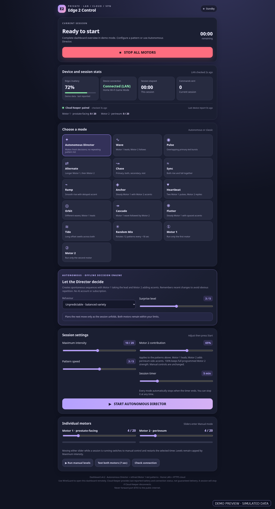
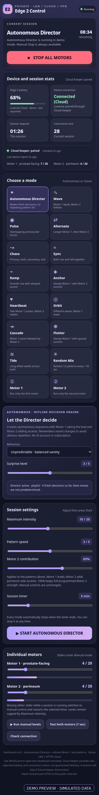
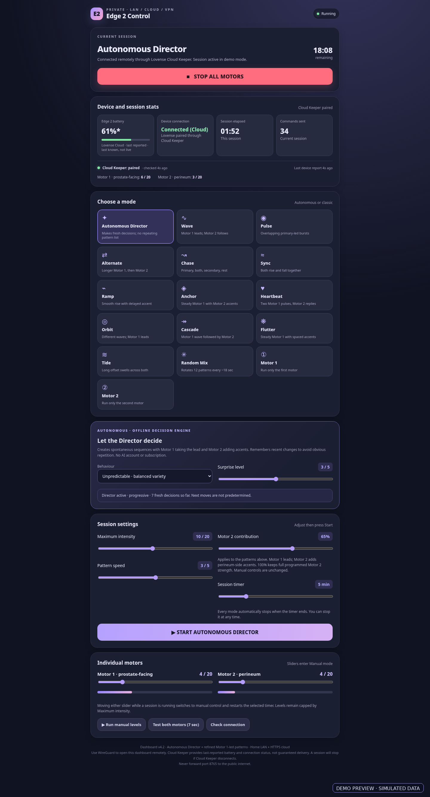

# PulseDirector

### A free, self-hosted controller for the **Lovense Edge 2**

> **Pre-release · Edge 2 only.** The software is being tested and is **not yet available as a supported public release**. This repository currently hosts project information and documentation. Please wait for a tagged release before following the installation guide with real hardware.

PulseDirector is an independent, self-hosted Linux project, initially developed and tested on a Raspberry Pi with a phone-friendly web dashboard, independent dual-motor control, custom patterns, and an autonomous pattern engine called **Director**. It works on a home network through Lovense Remote's Game Mode and can optionally use Lovense's remote APIs with a separate Cloud Keeper process.

**No paid AI service is required.** The Director uses weighted, stateful randomisation—not an AI chatbot or a remotely controlling person.

## At a glance

| | |
|---|---|
| **Supported device** | **Lovense Edge 2 only** |
| **Platform** | Linux with Python 3 (initially tested on Raspberry Pi OS) |
| **Interface** | Mobile-friendly browser dashboard |
| **Modes** | Waves, pulses, alternating, heartbeat, cascade, and autonomous Director |
| **Motors** | Independently adjustable Motor 1 and Motor 2 |
| **Session length** | Up to 20 minutes with timed Stop commands |
| **At home** | Lovense Remote Game Mode on the same LAN |
| **Away from home** | Private VPN for the dashboard + optional Lovense HTTPS cloud control |
| **Cost** | Free software; API availability and provider terms may change |

## Screenshots

A look at the **Edge 2-only dashboard**, rendered from the v4.2 interface with **simulated demo data**. Screenshots show the complete interface, not cropped sections. **Click an image to view it full-size.**

### Desktop dashboard

Choose from classic motor patterns, configure Autonomous Director, monitor device status, and use manual motor controls.

<p align="center">
  <a href="docs/images/edge2-screenshot-1-desktop-overview.png">
    
  </a>
</p>

<details>
<summary><strong>📱 Mobile — Autonomous Director running</strong></summary>

<br>

See a timed autonomous session, live motor levels, and the phone-friendly layout.

<p align="center">
  <a href="docs/images/edge2-screenshot-2-mobile-autonomous.png">
    
  </a>
</p>

</details>

<details>
<summary><strong>☁️ Remote control — Cloud-connected session</strong></summary>

<br>

A simulated remote session with Cloud Keeper status, connection details and the last reported battery level.

<p align="center">
  <a href="docs/images/edge2-screenshot-3-cloud-connected.png">
    
  </a>
</p>

</details>

*All screenshots are demonstrations, not recordings of an active device. They contain no real user credentials, personal IP addresses or private device identifiers.*

## The autonomous Director

The Director varies two-motor intensity and rhythm over time rather than looping through fixed patterns. Four behaviours are planned for the first release:

- **Unpredictable:** balanced variation without a fixed repeating sequence.
- **Patient:** longer phases with breathing room and pauses.
- **Playful:** more contrast, accents, and changes in rhythm.
- **Progressive:** gradual variation over the session.

Intensity, speed, surprise, Motor 2 contribution and the session timer remain under your control. Motor 1 is the lead channel in the default pattern designs. Direct manual control of either motor remains available.

## How it works

```text
Browser on your phone or computer
             |
      Private home LAN or VPN
             |
 Linux host: PulseDirector dashboard
         /             \
   Home LAN          Lovense HTTPS cloud
     |                     |
Lovense Remote       Cloud Keeper maintains pairing
     |                     |
     +-------- Phone + Bluetooth --------+
                        |
                  Lovense Edge 2
```

Cloud Keeper watches pairing and reports the **last known** battery and connectivity information; it does not send motor commands. Cloud status is not proof that every command was physically delivered.

## Getting started

**The controller source and installation package are not published yet.** Once a tested release is available, start with the **[step-by-step installation guide](docs/INSTALL.md)**. It covers Windows-to-Pi SSH, Python setup, home-LAN control, developer-token handling, QR pairing, system services and accessing the dashboard through a VPN.

Other guides: [Troubleshooting](docs/TROUBLESHOOTING.md) · [Security and privacy](docs/SECURITY.md) · [Service setup](docs/SERVICES.md) · [Release checklist](docs/RELEASE_CHECKLIST.md).

## Supported devices — important

**Only one Lovense Edge 2 is supported.** This release is **not for Max 2**, other Lovense models, or simultaneous multi-device sessions. The candidate includes checks intended to reject unsupported or ambiguous device reports, but this protection has not been exhaustively validated across firmware versions. Disconnect other devices before testing.

Additional models, including Max 2, may be investigated in future **separate, clearly labelled** releases after real-device testing. They are not currently promised or supported.

## Safety and privacy

- Test with the device **off-body** first and at a low intensity. Have an independent physical way to disconnect it.
- Keep the dashboard on a trusted LAN or private VPN. **Never forward its plain-HTTP port (default `8765`) to the public internet.**
- Keep API tokens, login keys, QR codes, device IDs, personal addresses and private configuration **out of GitHub**.
- Timed commands and a Stop button reduce risk but cannot guarantee immediate stopping during Bluetooth, phone, or internet failure.
- The dashboard can show **stale battery data** in cloud mode. Treat the timestamp as important and consult Lovense Remote for the freshest available value.

See the [full security guide](docs/SECURITY.md) before using remote control or contributing.

## Status and roadmap

**Current status:** v0.1.0 Edge 2-only release candidate; live testing and release review pending. No public release has been issued.

Potential future work: richer random behaviour, battery-reporting improvements, installation automation, and additional device research.

## Support future hardware development

PulseDirector is free, independent, and currently supports **the Lovense Edge 2 only**. Testing other models requires access to real hardware. If you'd like to help with future compatibility research, you can optionally [gift a device through the development wishlist](https://www.lovense.com/wish-list/3h7t6t3).

Gifts are appreciated but do **not** guarantee support for a particular model or a development timeline. This is not affiliated with, sponsored by, or endorsed by Lovense.

## Contributing

Once the first tested release is available, feedback, bug reports and documentation improvements will be welcome. Please don't submit credentials, pairing QR images, logs containing identifiable information, or unverified compatibility claims. Testing on other toy models is **not** supported by the Edge 2 release.

## Licence and attribution

The planned open-source licence is **MIT**, subject to final confirmation at release. This is an **independent community project**, not created, sponsored, approved or endorsed by Lovense. Lovense and Edge 2 are trademarks of their respective owner. Use of Lovense's APIs is governed by their own terms and availability.