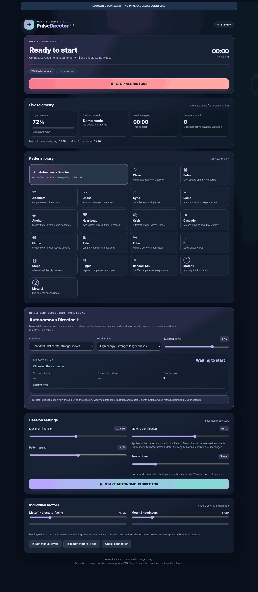
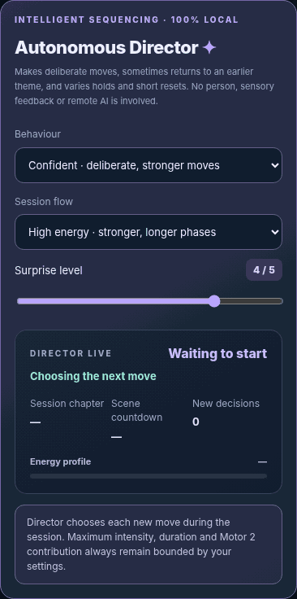

# PulseDirector

**v4.5.0 LAN Edition — release candidate**  
A free, self-hosted, browser-based controller for **one Lovense Edge 2**, running on Linux or Raspberry Pi OS with Lovense Remote's **local Game Mode** API.

[](https://github.com/Otautahi/pulse-director/actions/workflows/tests.yml)


[](LICENSE)

> **EXPERIMENTAL RELEASE CANDIDATE — NOT A STABLE RELEASE:** The original candidate allowed vibration to resume continuously after Bluetooth reconnect. The updated candidate automatically retries Stop on reconnection and locks the session after a fault. In one off-body test the Edge 2 **vibrated briefly on reconnect, then stopped automatically**; on a separate Wi-Fi interruption test it stayed stopped. These observations are not proof of a physical fail-safe: communication loss can prevent remote Stop. See [issue #2](https://github.com/Otautahi/pulse-director/issues/2) and [recovery validation](docs/RECOVERY_DESIGN.md).

> **Release/publication gate:** The public source branch is already visible, but merging into `main` and publishing a stable GitHub Release are on hold pending clarification of Lovense's third-party [API redistribution terms](https://www.lovense.com/app-develop-api), especially section 3.5. See [issue #4](https://github.com/Otautahi/pulse-director/issues/4). A source licence does not confer permission to use or redistribute vendor materials.

## What you get

| Feature | LAN Edition |
| --- | --- |
| Independent Motor 1 and Motor 2 control | Yes |
| 20+ selectable modes and manual motor controls | Yes |
| Autonomous Director with intentional, stateful sequences | Yes |
| Director behaviours | Confident, Unpredictable, Patient, Playful, Progressive |
| Session flows | High energy, Balanced, Build, Waves |
| Adjustable Surprise | 1–5 |
| Holds, scene switches, pattern callbacks and live intent display | Yes |
| Intensity, session time and Motor 2 contribution caps | Yes |
| Local browser interface and access key | Yes |
| Offline simulation | Yes |
| Cloud API, Cloud Keeper or public internet control | **Not included** |
| Max 2 or simultaneous multi-device control | **Not supported** |

The Autonomous Director is a **local, rule-based controller**, not a remote human or a model that can sense reactions. Its status messages describe programmed decisions; they do not imply feedback from your body or a live operator.

**Hardware verification:** One Edge 2 was tested off-body with both motors, timed Director sessions, manual Stop, Bluetooth/Wi-Fi loss and recovery. The owner ran 39 offline tests; GitHub Actions passed Python 3.11 and 3.13. The concurrent Start/Stop protection is tested offline only. These tests cannot guarantee physical stopping under every fault.

## Quick start on Raspberry Pi / Linux

Requires **Python 3.10+**, Git, a Lovense Edge 2 and a phone running Lovense Remote with **Game Mode** enabled. No external Python packages, cloud account, cloud token or pairing QR are needed for this edition.

This is a **release-candidate branch**, not a tagged stable release. Install into a new directory:

```bash
git clone --branch release/v4.5.0-lan-rc1 --single-branch https://github.com/Otautahi/pulse-director.git
cd pulse-director
python3 -m unittest discover -s tests -v
```

Try the offline UI on the Pi first:

```bash
python3 edge_dashboard.py --simulate
```

Simulation listens on `127.0.0.1:8765` by default and does not send motor commands. On a headless Pi, see the [installation guide](docs/INSTALL.md) for viewing the dashboard safely.

To use the **real Edge 2** on a trusted LAN, get your phone's *Game Mode IPv4 address*, then run (replace placeholders with your own addresses):

```bash
python3 edge_dashboard.py --phone YOUR_PHONE_LAN_IP --bind YOUR_PI_LAN_IP
```

Open `http://YOUR_PI_LAN_IP:8765` on a device connected to the same trusted LAN and enter the access key printed in the terminal. The generated key is stored locally in `.edge_dashboard_key`; **never commit or share it**.

**[Full installation guide](docs/INSTALL.md)** · **[Off-body hardware test](docs/HARDWARE_TEST.md)** · **[Security and privacy](docs/SECURITY.md)** · **[Troubleshooting](docs/TROUBLESHOOTING.md)**

## What it looks like

These are screenshots of the actual v4.5 LAN dashboard rendered with **simulated data only**. No physical Edge 2 was connected, and no personal addresses, device IDs or access keys appear.

**Desktop — complete interface**

[](docs/images/lan-desktop-overview.png)

<details>
<summary><strong>Mobile — Autonomous Director settings</strong></summary>



</details>

The mobile image shows the Director panel rather than an entire scrolling phone screen. Older cloud-mode screenshots are excluded. See [screenshot notes](docs/images/README.md).

## Architecture

```text
Browser on trusted LAN / private VPN
             |
 PulseDirector (Pi / Linux; port 8765)
             |
 Lovense local Game Mode API (phone:20010)
             |
 Lovense Remote app on phone
             |
      Bluetooth → Edge 2
```

The Pi contacts the **phone**, not the toy directly. Keep the Pi and phone on a mutually reachable trusted network. Local control does not mean the Lovense phone app itself is entirely offline; it means **PulseDirector sends no motor commands through a cloud API**.

## Compatibility and important limits

- **One connected Edge 2 only.** The release candidate rejects zero, multiple, ambiguous and unrecognised device reports, including Max 2; this compatibility check still requires validation against live firmware.
- No device-control commands should be sent without the physical device owner present and consenting.
- Stop, timers and short-duration commands are **best effort**: a phone, Wi-Fi or Bluetooth failure can delay or prevent immediate stopping. Keep an independent physical disconnect available.
- Battery and connection status are reports from Lovense Remote, not independently measured values. A successful API response does **not** prove a motor moved.
- The interface uses **HTTP and a local access key**, not HTTPS. Never forward port 8765 to the internet.

See the [release checklist](docs/RELEASE_CHECKLIST.md) for what remains before we can call this stable.

## Project status and roadmap

**Now:** public source-code release candidate in `release/v4.5.0-lan-rc1`, with 39 automated offline tests and limited real-device validation. The `main` branch remains unchanged; [draft PR #1](https://github.com/Otautahi/pulse-director/pull/1) is held for legal and final-release checks.

**Before a stable tag:** clarify [Lovense API redistribution terms](https://github.com/Otautahi/pulse-director/issues/4), finish fresh-install and privacy/security review, assess residual [Bluetooth reconnect risk](https://github.com/Otautahi/pulse-director/issues/2), and obtain final owner approval. Do not treat the observed automatic Stop on reconnect as guaranteed. See [hardware results](docs/HARDWARE_TEST.md).

**Possible later work (not promised):** expanded device telemetry, smoother setup, user feedback on Director sequencing, and separately validated Max 2 support. The public v4.5 LAN edition does **not** support Max 2.

[Contributions and bug reports](CONTRIBUTING.md) are welcome; please **remove logs, addresses, access keys, pairing data and device IDs** before sharing.

## Licence and independence

PulseDirector's own source code is published under the [MIT licence](LICENSE). This does not grant any rights in Lovense's software, services, names or APIs. The project is **independent and not affiliated with, sponsored by or endorsed by Lovense**. Applicable third-party developer/API and redistribution terms **must be clarified** before a stable release; in particular section 3.5 of the [Lovense agreement](https://www.lovense.com/app-develop-api) raises an unresolved public-repository distribution question ([issue #4](https://github.com/Otautahi/pulse-director/issues/4)).
